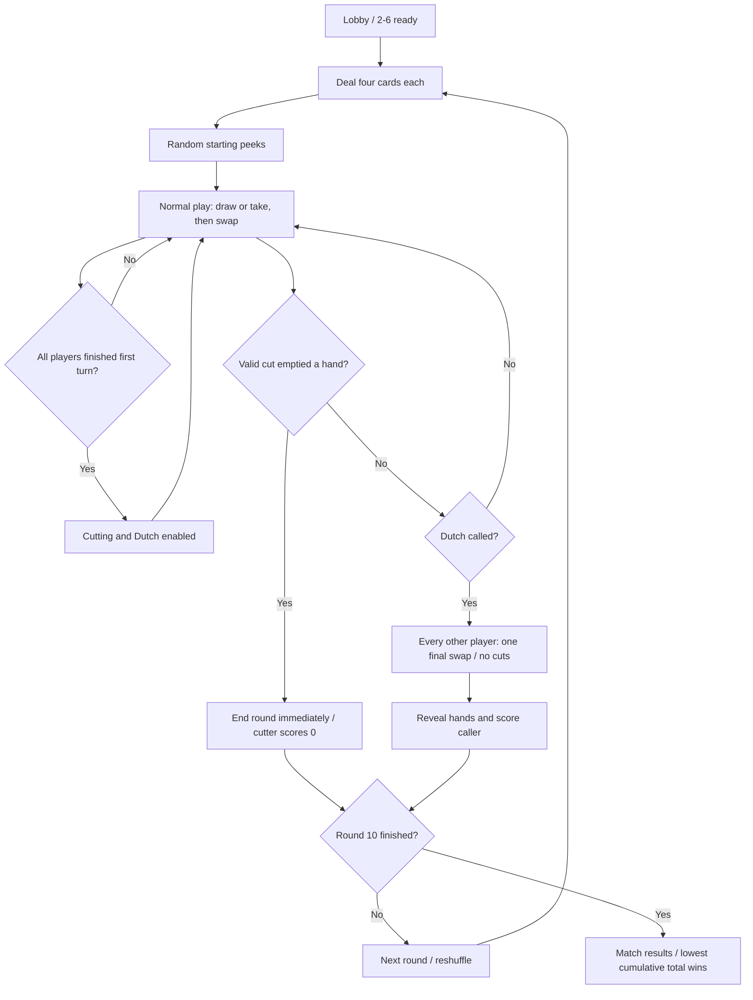

DUTCH — Implementation specification for ismlmhfz/dhiheh
Repository: https://github.com/ismlmhfz/dhiheh
Target: Add a fully playable, server-authoritative, real-time Dutch card game for 2–6 individual players, without modifying or breaking the existing 10 Card Club game.
Document status: Implementation-ready specification based on the rules supplied by the game owner. Any unconfirmed choices are labelled [IMPLEMENTATION DEFAULT — CONFIRM], and must be kept configurable rather than presented as definitive rules.

1. Mission and integration constraints
Implement Dutch as an additional game that players can select, create, join, play, spectate (without seeing secrets), and finish over 10 rounds on desktop and mobile. Keep the existing 10 Card Club functionality available and unchanged.
Verified repository architecture (main branch, inspected 2026-11-18)
- Backend: Django 5.2-compatible Python application, Django Channels/ASGI, room state in Room.state JSON; SQLite local, PostgreSQL + Redis recommended in production.
- Existing rules: game/engine.py implements the four-player team game "10" with 13-card hands and trick-taking. Do not replace this engine or reuse its trick logic for Dutch.
- Room and mutations: game/service.py manages rooms, player identity, seating, bots, transactions, command deduplication, and lifecycle. Its four-player assumptions mean it must not be used unchanged for Dutch gameplay.
- WebSockets: game/consumer.py broadcasts updates over /ws/room/<code>/; ten/asgi.py sets up channel routing.
- REST: game/views.py exposes /api/<action>/; ten/urls.py contains URL routing.
- UI: templates/index.html, static/app.js, static/game.css, static/table.css, static/mobile.css implement the 10 table. Avoid mixing Dutch card rules into these files.
- Shared services: game/models.py contains Room, ChatMessage, social models. game/chat.py, account/profile code, invitations and spectators may be reused carefully.
- Known existing four-player assumptions: game/service.py enforces four seated players, teams and opposite seating; game/consumer.py voice recipient validation uses range(4); game/spectator.py exposes 10-specific fields; existing static/app.js renders 4 directional seats; game/invitations.py refers to four empty seats when state is missing. All must be audited before shared usage.
- Tests: existing Django tests under game/tests.py and game/test_*.py must continue to pass.
- Deployment: repository README.md says pushing source does not automatically deploy the production website.
Preferred implementation architecture
Create a separate Dutch implementation that reuses Room, session identity, database, Channels layer, CSRF protection, login, safe chat primitives, and styling tokens, but isolates Dutch's rules and private player state.

Suggested file additions:
game/
  dutch_engine.py          # Pure, deterministic Dutch rules and scoring
  dutch_service.py         # Atomic room mutations, permissions and game lifecycle
  dutch_consumer.py        # Dutch websocket action routing and seat-scoped snapshots
  dutch_views.py           # Dutch landing, table and POST API
  dutch_bots.py            # Optional, milestone 2; uses only bot-visible information
  test_dutch_engine.py     # Pure rules, fuzz/property-style and edge tests
  test_dutch_service.py    # Concurrency, permissions, persistence and API tests
  test_dutch_ws.py         # WebSocket snapshots and timer tests

templates/dutch/
  index.html               # Dutch lobby, game table and rules

static/dutch/
  dutch.js                 # Network, render, card selection, timed reveals
  dutch.css                # Responsive 2–6 seat tabletop, piles and scoreboard
Routes, names and classes can vary if the implementation is coherent. Suggested paths:
GET  /dutch/                       Dutch home / new table
GET  /dutch/room/<ROOM_CODE>/       Join or resume the Dutch table
POST /dutch/api/create/            Create Dutch room
POST /dutch/api/<action>/          Join, lobby management and fallback actions
WS   /ws/dutch/<ROOM_CODE>/        Authoritative Dutch real-time channel
Do not redirect existing /room/<code>/ or /ws/room/<code>/ traffic into Dutch. Assign Room.state['game_type'] = 'dutch' and enforce it in the Dutch route, consumer and service. Existing rooms without game_type default to ten; don't rewrite their stored states. Optionally add a Play Dutch choice on the existing landing page once the standalone mode works.

If extracting truly shared room utilities from game/service.py, do so with regression tests and without altering the current 10 Card Club behavior. It is acceptable for v1 to keep a small, explicit Dutch-specific lobby service to reduce regression risk.
2. Authoritative game rules
2.1 Setup
1. Players: 2–6, individual play. There are no teams.
2. Use a standard 52-card deck, four suits, ranks A,2,3,4,5,6,7,8,9,10,J,Q,K, with no jokers by default.
3. Shuffle using a server-side cryptographically secure RNG. Deal four cards face down to each player, in fixed visually identifiable slots.
4. Place the next undealt card face up as the first card in a discard pile at the middle. All other undealt cards form the face-down draw pile. These are the only two central piles.
5. At the beginning of a match, randomly select the number of starting cards that each player is allowed to inspect privately. The server determines the number, and players select which of their own card positions to view. After inspection, they become face down again. This does not remove or swap any cards.
6. Randomly choose the starting player. Other players follow a consistent rotation order.
7. Players must complete their starting peek phase before gameplay begins; no one is allowed to see another player's private reveals.
[IMPLEMENTATION DEFAULT — CONFIRM] Starting peek count is one shared random integer from 1 through 4 per match (rather than a separate count for each player, and rather than rerolling each round). Starting peek duration: 3 seconds after the cards are selected. Both are configurable. The rule owner has confirmed only that the initial number is randomized, not the random range, per-player behavior, or initial peek duration. Do not treat these defaults as original game rules.

[IMPLEMENTATION DEFAULT — CONFIRM] Use clockwise turn order, since direction has not been specified for Dutch. Current 10 Card Club uses counterclockwise turns; do not automatically transfer that rule to Dutch.
2.2 Normal turns — take and swap
The active player must choose one of two sources:
- Face-up pile: take the currently visible top card from the discard pile and swap it with one selected face-down card from their own hand. Put the displaced hand card face up on the discard pile.
- Face-down pile: draw the top hidden card, privately view it for exactly 2 seconds, then select one hand-card position to replace with it. Put the displaced hand card face up on the discard pile. Hide the drawn card face again after the 2-second preview, even if the player has not yet selected a replacement slot.
The player's hand-card positions remain stable unless explicitly removed by cutting. The replaced card is always publicly discarded. This is a required swap: the initial implementation must not add a third option to draw and discard the drawn card without replacing a hand card, since that has not been specified.

Important UX: A player can see a card's actual value during a valid peek, but at all other times cards in their own hand display backs. The client is expected to help the human remember the cards, not to permanently label previously peeked values.

The server owns drawn cards, swaps, time windows, and validation. Never trust a client-submitted card rank or value.
2.3 Unlock conditions
Cutting and calling Dutch are locked until every seated player has completed their first turn of the current round. Track completion by player/seat, not a global fixed count, since a cut may alter turn order after the unlock. Both mechanisms become available after all have acted once.

[IMPLEMENTATION DEFAULT — CONFIRM] A Dutch call is allowed on the caller's own normal turn (instead of drawing/swapping), only when there are no unresolved cuts or card previews. The owner specified when Dutch becomes available, but did not specify whether it may be called outside one's own turn. Keep this policy configurable.
2.4 Cutting: discard matching ranks
Once cutting is unlocked, any player, including a player whose normal turn it is not, may attempt a cut immediately after a card is discarded on the central face-up pile.
- A cut matches the rank only, regardless of suit. Example: discarding 2H lets a player cut their known 2C.
- The cutting player selects one or several cards from their hand (a multi-cut). They may cut as many cards as they have that match the current discard rank.
- Success: every selected matching card leaves that player's hand and is added to the face-up pile. The hand shrinks permanently. The cutting player becomes the next active player, interrupting the previous turn order.
- Failure: if a player tries to cut a card of the wrong rank, add one extra card face down from the draw pile to their hand. They must not view the penalty card.
- When a player successfully cuts away every remaining card, the round ends immediately, without giving anyone else a final turn. That player wins the round with 0 points. Every other player reveals and scores the total value of their remaining cards.
- The cut option is completely disabled during the final-turn period after a Dutch call.
[IMPLEMENTATION DEFAULT — CONFIRM] Treat a multi-cut as one atomic action: if every selected rank matches the current discard, remove all; if any selected card does not match, remove none and issue one penalty card (not one penalty per wrong card). A failed cutter becomes the next active player as with a successful cut. These exact batch-failure and failed-cut turn-transition behaviors were not separately confirmed; keep them configurable.

[IMPLEMENTATION DEFAULT — CONFIRM] Allow a single authoritative cut claim per discard event during a server-timed 3-second cut window. The first validly received command wins the race; others receive a harmless 'window closed' response. A player may make additional cuts at later discard opportunities. Successful cuts of matching cards may trigger a fresh cut window for the latest discarded card, unless the hand becomes empty. Avoid simultaneous owners or more than one accepted cut against a stale discard event.
2.5 Jack's special power
When a Jack (J) is placed on the face-up discard pile, the player who placed it there receives a private 1-second peek at one chosen card in their own hand.
- The Jack trigger is about a card being discarded, not about drawing or holding a Jack.
- The 1-second peek never reveals any other player's cards.
- The card returns face down after 1 second, and the peek does not itself constitute a swap or cut.
- Any card position selected must currently exist in the player's hand. If the round has ended, pending Jack peeks expire.
- The ability does not alter turn order and cannot override a round-ending empty-hand cut.
[IMPLEMENTATION DEFAULT — CONFIRM] Trigger the Jack power for a Jack discarded by a normal swap and for a Jack successfully cut onto the pile. A Jack discarded during the Dutch final-swap period may still grant its normal 1-second peek (it is an incidental card effect, not an additional cut or swap). The exact scope of Jack effects has not been specified in more detail; keep it configurable.
2.6 Calling Dutch
After all players have completed at least one turn in the round, an eligible player may declare DUTCH because they believe their remaining hand total is the lowest.
1. The caller's participation in the round ends immediately; the caller receives no final turn.
2. Every other player gets exactly one final turn, taken in rotation order after the caller, and may only perform a normal take-and-swap using one of the two middle piles.
3. No player can cut during this final-turn phase; cutting buttons and server actions must be disabled.
4. After the last other player completes the final swap, reveal all remaining hands and score the round.
5. If the caller has the lowest hand total, the caller scores 0 points, regardless of their actual hand total.
6. If another player has a lower total, the caller's own remaining hand total is doubled for that round. All other players score their unmodified hand totals.
7. A Dutch call cannot be cancelled or repeated within the same round.
[IMPLEMENTATION DEFAULT — CONFIRM] If the caller is tied for lowest, count the call as successful (zero points). The original rules specify "lowest" but do not say how ties are handled. Make this a settings switch.

No cuts means no empty-hand cut victory in the Dutch final-turn phase. The round instead completes after all required final swaps.
2.7 Rounds and overall victory
- A match consists of exactly 10 rounds.
- Every round ends either by completed Dutch final turns or immediately when a player cuts their last card.
- For an empty-hand cut, cutter = 0 points, everyone else = face-value sum of cards still held.
- For a successful Dutch call, caller = 0 points, everyone else = face-value sum.
- For a failed Dutch call, caller = 2 × their own face-value sum, everyone else = face-value sum.
- Cumulative scores carry through all 10 rounds, including penalty points from failed Dutch calls.
- After round 10, the player(s) with the lowest cumulative score win the match; display all players' results and a clear Play Again option.
[IMPLEMENTATION DEFAULT — CONFIRM] Card point values: A=1, 2–10 as printed, J=11, Q=12, K=13. The owner has not yet specified these values. Centralize the mapping in a configurable rule constant, and display the mapping in the in-app rules rather than hardcoding different values across backend and frontend.

[IMPLEMENTATION DEFAULT — CONFIRM] Ties for the match's lowest final total produce joint winners unless a separate tiebreak rule is provided. No invented tiebreaker.
3. Domain model and state machine
The server must be authoritative. Store all cards and temporary access windows only in server-controlled Room.state; send each client an individually redacted projection. Never send every player's hidden cards to the client and attempt to conceal them with CSS.

Recommended persisted shape (illustrative, not literal migration SQL):
state = {
  "game_type": "dutch",
  "schema_version": 1,
  "status": "lobby",            # lobby | initial_peek | playing | dutch_final | round_results | match_results | abandoned
  "host": 0,
  "players": [None] * player_limit,  # 2..6; each seated player has a stable identity
  "player_limit": player_limit,
  "round": 0,                 # 1..10 while active
  "max_rounds": 10,
  "scores": [0] * player_limit,
  "round_history": [],
  "starter": None,
  "turn": None,
  "direction": 1,            # explicitly configured, never implied from the 10 engine
  "hands": [],                # private: array of arrays with opaque stable card ids
  "cards": {},                # private: card_id -> rank + suit; server only
  "draw_pile": [],            # private ordered card ids
  "discard_pile": [],         # public top card; entire pile may be in private state
  "peek_count": None,
  "initial_peeks_done": [],
  "first_turn_done": [],
  "draw_preview": None,       # private target, card_id, reveal_until
  "jack_peeks": {},           # seat -> pending/active peek info with expiration
  "cut_window": None,         # event_id, rank, expires_at, accepting
  "dutch_caller": None,
  "final_turn_order": [],     # exactly every other seat, each once
  "final_turn_index": 0,
  "round_result": None,
  "winner_seats": [],
  "paused": False,
  "commands": [],             # bounded idempotency log
  "revision": 0,
}
Use real player identities (not only seat integers) to associate temporary actions safely. Assign unique per-card IDs so duplicate card ranks never cause UI or protocol ambiguity. Per-round shuffling must use one normal deck, avoiding duplicate cards within the same round.
State transitions

Gameplay subphases
Use small, testable subphases rather than a collection of unrelated flags. In particular:
- normal_choice: current player may take visible discard or draw hidden; Dutch call may also be accepted when unlocked.
- draw_reveal: the drawing player alone may see the drawn card's face until reveal_until = server_now + 2.0; hand swap can be selected once they know the draw, and may complete after the reveal hides.
- swap_select: player must choose exactly one of their current hand slots; persist the swap only once.
- discard_resolving: open a cut window if unlocked and not in dutch_final; resolve possible Jack peek independently and prevent two races from choosing the next turn.
- initial_peek: each player chooses valid starting positions and privately views them for the configured time; start first turn only when all are finished (or timed out by policy).
- dutch_final: run through a fixed list of opponents, one swap each, then reveal and score. Do not allow normal cut or Dutch call actions.
- round_results/`match_results`: immutable results until next-round or rematch transition.
Timer rules: Server time is authoritative. A page refresh, multiple browser tabs, or modified JavaScript must not lengthen a 2-second draw reveal or 1-second Jack peek. Expire access at the server before constructing any snapshot. The browser should also hide values exactly on schedule for smooth UX, but is not a security boundary. Existing RoomConsumer.watch() already ticks every second; implement sufficiently precise scheduled cut/peek expirations for Dutch, with server timestamps and a safe timeout fallback.
4. Backend API and event protocol
All commands should be checked for:
- Correct game type, room, authenticated session identity, seated player, phase, seat/turn ownership, and requested card IDs.
- Server-owned current discard rank; do not accept a submitted rank as proof of a cut.
- Idempotency: a client-generated command UUID must not draw twice or double-penalize on retry.
- Room-level transaction.atomic() + select_for_update() (same pattern as existing game/service.py). Keep mutations and timer transitions inside one serialized transaction. The existing thread lock is not a distributed production lock; the database lock is what matters across workers.
- A monotonic room revision or event ID. Ignore stale cut or swap actions targeting an earlier discard/turn.
- Safe reconnection: a reconnecting seated user recovers their own current phase, card positions and remaining private peek window, but never any other player's secrets.
Suggested WebSocket commands:
Action	Fields	Meaning
dutch.ready	command	Toggle readiness in lobby
dutch.start	command	Host starts with 2–6 occupied/ready seats, depending on chosen room capacity
dutch.initial_peek	card_ids, command	Choose exactly permitted own positions for starting peek
dutch.take_discard	slot_id, command, revision	Atomically take visible top card, swap with own slot, discard displaced card
dutch.draw	command, revision	Reserve/draw hidden top card and privately show for 2 seconds
dutch.swap_drawn	slot_id, command, revision	Finish mandatory swap of already reserved drawn card
dutch.cut	card_ids, discard_event_id, command	One or multiple matching-rank cut attempts; server validates the batch
dutch.jack_peek	slot_id, command	Choose own card for private 1-second Jack power
dutch.call	command, revision	Call Dutch when eligible; establish the final opponent order
dutch.next_round	command	Host advances after results, until round 10
dutch.rematch	command	Reset points and start new 10-round match
dutch.resync	none	Return fresh redacted snapshot

Note: take_discard is a single atomic exchange; do not temporarily expose the taken face-up card in a second client's hand state. draw is a private reservation until swap_drawn commits it. If the drawer disconnects mid-swap, persist reservation and allow resumption; don't lose or duplicate a deck card.

Server-generated notifications can use: round.started, peek.available, draw.preview, card.discarded, cut.opened, cut.accepted, cut.penalty, jack.available, dutch.called, final.turn, round.finished, match.finished and game.error. Public notifications must not contain hidden card values. Preserve existing room-chat event names if reusing chat.
Carefully implement a cut window
1. Upon a normal swap discard, commit discard_event_id, top_rank and cut_window.expires_at atomically, only if cutting is unlocked.
2. Send a public top-discard notification; allow off-turn players to submit cut card IDs by deadline.
3. On each cut command, lock the room, verify the exact discard_event_id, the server timestamp, no unresolved round end, and all cards still owned by the cutter.
4. Validate the whole batch against the current top discard rank.
5. Success: move all selected cards to discard pile; make cutter the next normal turn owner; if their hand is empty, finish the round right now and cancel any remaining timers.
6. Failure: take one unknown card from draw pile into cutter's hand; record one penalty for that atomic attempt; apply configured turn-transfer rule.
7. Close or replace the old window; emit room updates. A rival's late attempt must not act on the previous event.
8. If nobody cuts before deadline, hand control to the next normal player. Any server-side preview or Jack peek may expire independently.
Do not allow a second client's success against the same card because both saw an open cut window. Define deterministic ordering by serialized server arrival, not client clocks.
Running out of draw cards
[IMPLEMENTATION DEFAULT — CONFIRM] When the draw pile empties, keep the current top discard face up, reshuffle the remainder of the discard pile into the hidden draw pile, and continue. If no cards remain available for reshuffling, block hidden-draw selection but allow legal face-up swaps and Dutch calls. Never duplicate or lose a card. If a penalty is due with no drawable card, record the situation and apply an explicitly configurable fallback; do not mint a nonexistent 53rd card.
5. Redacted views and anti-cheat requirements
The most important requirement: a browser client must never receive unearned hidden card faces or be able to deduce the deck order from stable public IDs.

Suggested snapshot separation:
Shared/public data:
  game_type, room, status, round, max_rounds, seat count,
  players' sanitized names/avatars/connection states,
  hand card COUNTS, turn owner, face-up discard TOP CARD,
  face-down draw COUNT, whether cutting/Dutch is enabled,
  active cut deadline/event id, who called Dutch,
  final-turn progress, cumulative scores, completed round results.

Viewer-specific private data:
  viewer seat, own opaque hand-slot ids (NOT faces),
  which own slots can be selected, own reserved drawn card
  face ONLY while active 2s reveal, own selected Jack card
  face ONLY while active 1s reveal, own initial peek card
  faces ONLY during authorized starting reveal.

Round-end disclosure:
  all players' remaining hands and score calculations,
  but ONLY once the server enters round_results or match_results.
- Never send hands, cards, draw_pile, discard_pile beyond the top card, commands, session IDs, auth IDs or other full internal state to spectators or other players.
- Make dutch_public(state, viewer_seat) an explicit allowlist serializer; avoid dict(state) followed by incomplete key deletion. Likewise create a separate safe spectator projection. Existing game/spectator.py is 10-specific; route Dutch spectators through a Dutch-safe implementation or disable spectating for the first milestone.
- Do not expose the hidden card's face in browser HTML/JS data attributes, localStorage, room-wide WebSocket messages, chat history, analytics, or accessible DOM outside the active reveal.
- Limit repeated peeks to the exact authorized 2-second, 1-second or starting-peek grant; server must not allow replaying them with reused commands.
- Public card IDs should be newly randomized per round, and only a player's own slot handles should be stable enough for interaction. Avoid leaking top-of-deck ordering.
- Keep session cookies HTTP-only and HTTP fallback CSRF-protected. Rate-limit room creation, join attempts, cut spam and WebSocket actions.
6. Game scoring pseudocode
CARD_POINTS = {
    "A": 1, "2": 2, "3": 3, "4": 4, "5": 5, "6": 6,
    "7": 7, "8": 8, "9": 9, "10": 10,
    "J": 11, "Q": 12, "K": 13,
}  # IMPLEMENTATION DEFAULT, configurable until owner confirms

def hand_total(hand_card_ids, cards):
    return sum(CARD_POINTS[cards[cid]["rank"]] for cid in hand_card_ids)

def finish_dutch_round(state, caller):
    assert state["status"] == "dutch_final"
    assert state["final_turn_index"] == len(state["final_turn_order"])
    totals = [hand_total(hand, state["cards"]) for hand in state["hands"]]
    lowest = min(totals)
    caller_success = totals[caller] == lowest  # tie policy is configurable
    earned = totals[:]
    earned[caller] = 0 if caller_success else 2 * totals[caller]
    finish_round(state, earned, reason="dutch", winner=caller if caller_success else None)

def finish_empty_cut_round(state, cutter):
    assert len(state["hands"][cutter]) == 0
    earned = [hand_total(hand, state["cards"]) for hand in state["hands"]]
    earned[cutter] = 0
    finish_round(state, earned, reason="empty_cut", winner=cutter)

def finish_round(state, earned, reason, winner):
    assert state["status"] not in {"round_results", "match_results"}
    for seat, value in enumerate(earned):
        state["scores"][seat] += value
    # Append an immutable copy to history, including actual cards and score breakdown.
    # Cancel card previews, cut windows and outstanding actions.
    # If round == 10, choose all seats tied for min(cumulative scores),
    # else transition to round_results and await an authorized next_round command.
Validation example: failed Dutch — Caller P2 has hand value 9; P1 has value 7; P3 value 12; P4 value 16. Caller P2 receives 18 points, while P1/P3/P4 score 7/12/16 respectively. Caller is not rewarded for initiating the round end.

Validation example: successful Dutch — Caller P2 has 5, other players have 7, 12 and 16: P2 scores 0, others 7/12/16. If another player overtakes P2 during their final swap, the call fails.

Validation example: empty cut — P4 cuts their last two cards correctly: the round ends immediately, P4 scores 0, everyone else reveals and scores their own remaining totals, even if it wasn't P4's normal turn.
7. User experience and visual requirements
Keep the premium, animated, polished feel of the current site, but give Dutch its own table visual language. Reuse brand variables and accessible controls where possible, not the existing four-seat trick UI.
Entry and lobby
- Provide a clear 10 Card Club / Dutch game selector or a dedicated Dutch page linked from navigation.
- Player chooses total seats 2, 3, 4, 5 or 6, display name and optional deck theme.
- Create short shareable room code and invite link. Support guest session players using existing identity behavior, with optional account profiles.
- Show occupied seats, waiting slots, ready toggles, connected status and a host-only Start button.
- Start with all selected seats filled and ready. Users should not be forced into teams or 4-player seating.
- Show a friendly rule overlay, especially cutting, Jack peek and Dutch final-turn lockout.
Table
- Responsive circular or elliptical tabletop, with 2–6 seats distributed evenly, each player's hand shown as four card backs initially (hand count may shrink from cuts or grow from penalties).
- Keep the user's own hand anchored at the bottom regardless of true seat order. Opponents' hands are card backs only; show their card counts.
- Clearly render two separate central piles: face-up discard pile showing exact top card, face-down draw pile with remaining count.
- Tap/click an allowed pile, then tap one of your own slots to swap. On hidden draw, show a large private 2-second reveal with a countdown before hiding.
- During initial_peek, highlight the exact number of selectable own cards. Show the chosen cards privately for the authorized duration, then flip them face down.
- After the first cycle, display CUT and CALL DUTCH availability. On a discard, show a short cut opportunity UI allowing multiple own card positions to be selected before one Cut Selected submission.
- When a cut is accepted, animate the selected cards toward the discard pile and update the cutting player's reduced hand. On an incorrect cut, animate one face-down penalty card into their hand and never display its face.
- On Jack discard, offer a choose-one-own-card overlay; show that card privately for 1 second and close it automatically.
- On Dutch call, add a prominent DUTCH CALLED indicator, mark the caller, show remaining final turns, disable all cut controls, and permit only a single take-and-swap for each opponent.
- On empty-hand cut, immediately show the win animation and round results — never run final turns.
- After each round, reveal everyone's cards, display hand subtotals and score changes, especially 0 for winning Dutch/empty cut and 2× for failed Dutch, and show cumulative scores.
- After the tenth round, show a final sorted scoreboard, the lowest-total winner(s), and a rematch control.
- Support keyboard operation, touch, reduced motion, visible focus, sensible card labels and WCAG-friendly contrast.
- Animations should not block game logic, hide important action availability or extend private reveal windows.
Mobile interaction requirements
- Design for 320px+ wide screens, with oversize tap targets, horizontally scrollable hand if penalty cards accumulate, and no page-width overflow.
- Use an overlay/drawer for cuts, scoring and rules so the main table remains legible.
- Do not rely on drag-and-drop alone; tapping a pile and then a slot must always work.
- Avoid showing an opponent's hidden card face during any flip animation or reconnection.
8. Bots and social features
Milestone 1 (required): Human multiplayer with private rooms and room sharing. Reuse current session identity, optional profiles and text chat safely. Keep existing friends/chat available elsewhere in the site. A Dutch voice/video feature is not required for initial acceptance, because the existing voice path assumes four seats.

Milestone 2 (optional): Dutch bots for solo/practice sessions. Bots must use only information a human player would have observed: their own currently authorized peeks, public discards, a small remembered card map and card counts. A bot must not inspect other hands, future deck cards or exact hidden values when choosing actions. Make bots aware of the 2-second draw reveal, optional Jack peek, cutting windows, Dutch risk, scoring and 10-round horizon.

Milestone 3 (optional): Integrate Dutch into friend/group invitations and spectating after refactoring the 10-only routing assumptions. Existing social match links use /room/<code>/; Dutch room links must go to /dutch/room/<code>/ and be resolved from the room's game_type. Spectator APIs must never leak hidden cards.
9. Edge cases that MUST be resolved
1. Two players cut the same discard simultaneously: only one accepted attempt per server event; other gets stale-event rejection with no penalty.
2. One player cuts multiple cards with different ranks: reject the batch or apply configured all-or-nothing failed-cut penalty; do not partially cut and inconsistently punish.
3. Cut after Dutch was called: reject, even if a cut button remained visible in a stale client.
4. Empty cut after a Jack discard: empty-hand round end outranks Jack peek; no further action or peek.
5. Player hand becomes 0 before the normal next turn: immediate score resolution and no subsequent final turn.
6. Draw preview expires during network latency: maintain reservation, hide the face after 2 seconds, permit the required slot swap without re-revealing.
7. Disconnect while in a cut window: client reconnection cannot restart a timed opportunity; server resolves window by deadline.
8. Disconnect after a Dutch call: preserve exact remaining final-turn order; pause/reconnect according to agreed timeout policy and never grant duplicate last turns.
9. Duplicate or late command: idempotent no-op or explicit stale-command error; never duplicate physical cards or points.
10. Penalty with an exhausted deck: safely replenish from eligible discard cards if possible; do not create cards from nothing.
11. Jack with zero legal peek targets: do not open a choice; if no cards remain, round must already have ended.
12. First-cycle qualification: cutting/Dutch unlock after all actual seated players each complete one swap; changes in hand count cannot bypass this.
13. 2, 3, 5, 6 players: seat rotation, final-turn order, snapshot counts, UI and end-of-round scoring work without hardcoded four-player assumptions.
14. 10th round: game transitions to match results exactly once, with no 11th deal and no premature stop based on a point threshold.
15. Scoring ties: apply configurable Dutch-tie policy; if equal cumulative totals remain after round 10, display joint winners by default.
16. Private data leak: verify every role — host, player, spectator, guest, non-member, disconnected tab — sees only authorized information.
17. Room collision: an existing 10 Club room code routed to /dutch/room/ must not load as Dutch and vice versa.
18. First discard pile: do not allow cutting the initial face-up card before first-cycle unlock.
10. Test plan and acceptance criteria
Implement unit, integration and end-to-end tests before production deployment.
Engine unit tests (game/test_dutch_engine.py)
- [ ] One shuffled 52-card deck has 52 unique cards and correct four-card deals for 2–6 players.
- [ ] Initial discard and draw pile counts are correct; no card is lost or duplicated after swaps/cuts/penalties/replenishment.
- [ ] Each initial peek is authorized, private, count-limited and time-limited.
- [ ] Only the active player may take a discard or draw a hidden card.
- [ ] Hidden drawn card is visible to drawing player for 2 seconds, then hidden while swap still works.
- [ ] Both take sources perform a required single-card swap; displaced card becomes top discard.
- [ ] No cutting and no Dutch are legal until each player finishes their first turn.
- [ ] Any card with matching rank regardless of suit is a valid cut.
- [ ] Three matching cards can be removed in one successful cut; cutting player receives next turn.
- [ ] Invalid single or batch cut adds exactly one unseen face-down penalty card.
- [ ] A Jack discarded from the hand grants a private 1-second peek and does not change turn order.
- [ ] A Dutch call captures opponent final-turn order (exactly N-1 players, exactly once).
- [ ] Final Dutch turns are swap-only; no cut or second Dutch call is accepted.
- [ ] A successful Dutch caller scores 0, even if their remaining hand total was nonzero.
- [ ] A failed Dutch caller scores exactly 2 × their own hand value; all opponents score normal values.
- [ ] A player cutting their final card scores 0 and ends the round immediately with zero final turns.
- [ ] A full match lasts exactly ten rounds; cumulative lowest score determines winner(s).
- [ ] Ties follow the configured policy; no phantom scores or double score application.
Integration and security tests (game/test_dutch_service.py, game/test_dutch_ws.py)
- [ ] Anonymous/guest sessions join a room by code, but unrelated sessions cannot act for occupied seats.
- [ ] Only host can start, advance, rematch and delete as applicable.
- [ ] Commands are transactional; concurrent cut and swap attempts never corrupt room state.
- [ ] Replayed command UUID never duplicates draws, cuts, penalty cards, Jack previews or scoring.
- [ ] Player A's WebSocket and REST snapshot never contain B's hidden card ranks, deck order or B's private reveal.
- [ ] Spectator/admin-view public APIs have deliberate allowlisted content.
- [ ] Reconnect and resync preserve game state while expired peeks remain hidden.
- [ ] Existing 10 Club endpoints/routes, game rules, tests and templates are unaffected.
- [ ] python manage.py test succeeds across the full repository.
Manual end-to-end test
Open 2–6 separate browser profiles, start a match, complete the initial peek, perform face-up and face-down swaps, verify peek timers, test single and multiple cuts, make an incorrect cut, test Jack, then run one successful Dutch and one failed Dutch. Verify the other players get exactly one last swap and cannot cut. Trigger an all-cards cut and verify no final turns occur. Finally play 10 rounds and verify the cumulative scoreboard.
11. Development sequence
1. Protect current 10: run python manage.py test on the baseline, capture results, and add an isolated Dutch module and routes.
2. Define typed rule configuration and engine: deck, card values, state machine, initial peeks, swaps, cut windows, Jack, Dutch final turns and scoring. Write engine unit tests first.
3. Build Dutch room service: session identity, 2–6 lobby/ready logic, host controls, atomic mutations, command deduplication, private projections, 10-round persistence and reconnection.
4. Build Dutch Channels consumer and REST fallback: private per-seat snapshots, room broadcast, server-owned timer expiry, stale-command protection.
5. Build Dutch UI: clean selection of cards/slots, central two piles, 2-second and 1-second peeks, multi-cut, Dutch call, animated final turns, all-players reveal and scoreboards.
6. Validate concurrency/security: stale cut racing, reconnect, duplicate requests, correct card conservation, redacted spectators.
7. Integrate game selection: add a visible Dutch entry point while leaving all 10 Club routes and behavior intact.
8. Run all tests and manually play entire 10-round matches for 2 and 6 players. Only then deploy separately using the repository's existing infrastructure/runbook.
Commands
python3 -m venv .venv
source .venv/bin/activate
pip install -r requirements.txt
python manage.py migrate
python manage.py test
python manage.py runserver 127.0.0.1:8000
On Windows PowerShell, use .venv\Scripts\Activate.ps1 for activation.
12. Ready-to-use coding-agent instruction
Read this entire DUTCH_IMPLEMENTATION.md and inspect the repository before editing. Implement a standalone Dutch mode in ismlmhfz/dhiheh, preserving the existing Django/Channels 10 Card Club unchanged. Follow the confirmed user rules verbatim: 2–6 players, 4 hidden cards each, two center piles, a random starting peek count, required swaps, 2-second private draw peek, cutting after everyone plays once, multiple same-rank cuts, one unseen penalty card for incorrect cuts, cutting player takes the next turn, 1-second Jack private peek, Dutch call after first cycle, N−1 final swap-only turns with no cuts, successful Dutch = 0 points, failed Dutch = 2× caller hand total, empty-hand cut = immediate 0-point win without final turns, and lowest cumulative score after exactly 10 rounds wins. Keep all remaining ambiguities in a single configurable rule object marked IMPLEMENTATION DEFAULT — CONFIRM. Write server-authoritative tests for private-card leaks, concurrency, timers and score calculations; then implement responsive tabletop UI. Execute the full existing Django test suite and report the files changed, test output and any remaining configurable defaults. Do not deploy to production as part of implementation.

13. Owner decisions still unconfirmed (do not invent silently)
All of the following are engineering defaults, not previously approved rules:
Topic	Current implementation default
Card face values	A=1; numbers as printed; J=11; Q=12; K=13
Random initial peek count	One shared random number 1–4, once per match
Starting peek duration	3 seconds
Play rotation	Clockwise
Dutch availability	Caller may call instead of taking a normal turn once first cycle is completed
Dutch ties	Tied-lowest caller counts as a successful call
Final match tie	Shared winners
Multi-cut containing a bad card	All-or-nothing, one unseen penalty card
Turn after invalid cut	Pass next move to cutting player
Cut opportunity deadline	3 seconds per discard event
Cutting a discarded Jack	Also triggers Jack's 1-second peek
Jack effect during Dutch final swaps	Allowed when a Jack is discarded through the required swap
Exhausted draw pile	Reshuffle discarded cards except current top
Next-round starting player	Reroll a random starter for every round

Expose these in one DUTCH_RULES object/constants module and test against that configuration. Confirmed behavior must never be overwritten by a default — in particular, no cuts during Dutch final turns and no final turns after an empty-hand cut.

Deliverable definition: a production-quality working Dutch game, integrated as an additional mode, with rule-accurate backend, responsive UI, 2–6 player realtime room handling, ten-round scoring, tests, and no regression to 10 Card Club.